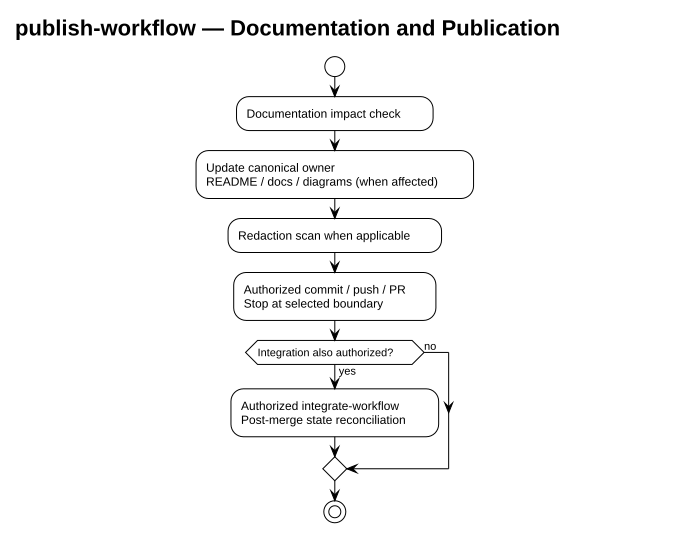
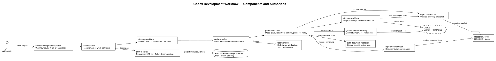
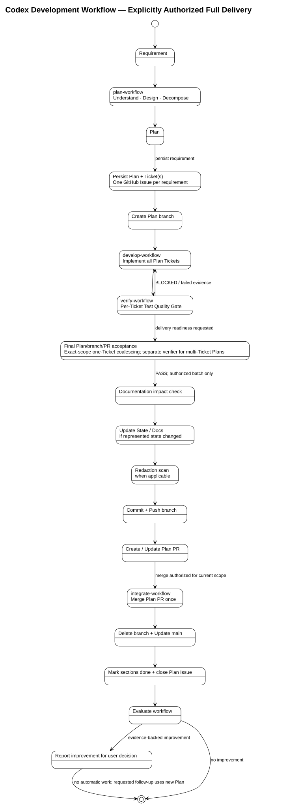
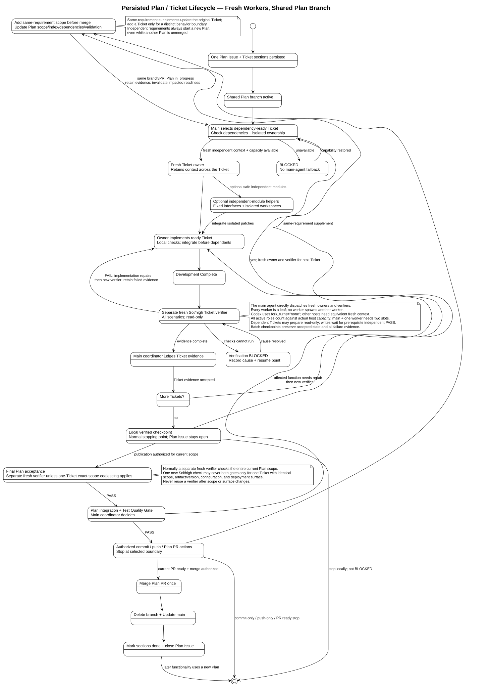
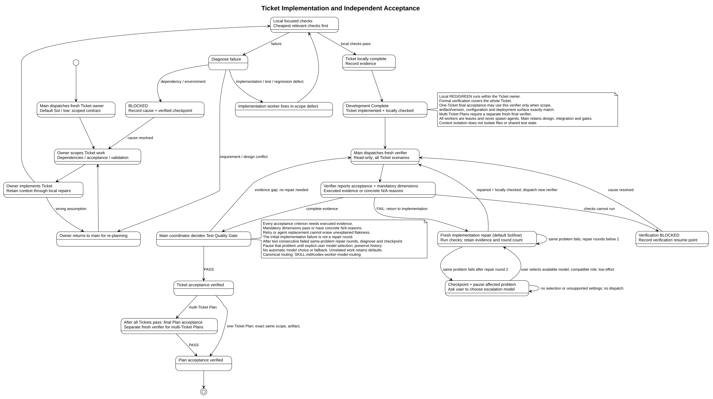

# Architecture Overview

> Type: Architecture
> Status: Active
> Scope: Component responsibilities, development lifecycle, and installation flow of this repository's workflow package

## Scope

This repository packages a main-agent-led development-workflow orchestrator for
Codex and Claude Code with a fixed workflow topology and single-agent execution
by default. The main agent implements, repairs and verifies directly without
subagents. Multi-agent execution requires explicit user authorization after the
documented escalation checkpoint; model selection alone does not enable it. The orchestrator owns stage routing and quality gates; specialist
procedures remain inside their own `SKILL.md` files.
Reasoning effort is low for single-agent work with a high planning exception;
delegated development/repair uses low and independent verification high.

## Components

Worker topology, dispatch and independent-verifier descriptions and diagrams
below apply only in explicitly authorized delegated mode. Default execution
keeps the same stage and evidence gates with self-verification by the main agent.


| Component | Responsibility |
|---|---|
| `codex-development-workflow` | Routes each request to the stage workflow that owns it — `plan-workflow`, `develop-workflow`, `verify-workflow`, `publish-workflow`, or `integrate-workflow` — carries the invariants shared by all stages, and provides the optional full orchestration for an explicitly authorized end-to-end delivery. |
| Dynamic Ready Queue | The main agent directly dispatches fresh Ticket owners and independent verifiers, requeueing work after each completion or material checkpoint. |
| Subagent selection | The main agent and host choose the best available built-in or project-defined subagent from the task contract and agent description; no task class is hard-coded to a named agent. |
| Codex worker model routing | Root [`SKILL.md`](../../SKILL.md#codex-worker-model-routing) owns portable worker defaults, precedence and escalation; direct develop/verify/test coordinators read the corresponding root from their active installation through the discovered Skill catalog. |
| `.codex/config.toml` and `.codex/agents/` | Separate project-local coordinator/worker configuration and optional scoped agent definitions; [installation.md](../deployment/installation.md#codex-model-routing) owns configuration and installation boundaries. |
| `plan-to-ticket` | Defines one Plan per independent requirement, ordinarily with one complete execution/acceptance Ticket; multiple Tickets require distinct behavioral, dependency, or acceptance boundaries. It persists Plan/Ticket sections before implementation edits. |
| Plan Markdown / legacy Issues | Stores authoritative new/legacy records; the Plan owns status, dependency index, branch, base, and PR metadata while its Ticket sections own behavior and acceptance metadata. |
| `test-workflow` | Maps acceptance criteria to evidence, selects mandatory risk dimensions, and closes the Test Quality Gate only when required verification is satisfied. |
| `repo-current-state` | Maintains the compact, verified recovery point on the same Plan branch and PR as the work it describes. |
| `repo-documentation` | Governs documentation as one canonical document per fact: the documentation impact check, canonical ownership, the documentation index, duplicate and orphan detection, document lifecycle, and the diagram policy. |
| `docs/skills/` | Specialist README, architecture, usage, and supporting documentation. |
| `scripts/install-all.sh` | Installs the root orchestrator and local specialist bundles. |
| `references/skill-map.md` | Maps each managed bundle to its local source and both host destinations. |
| `data-document-redaction` | Scans the files staged for the next commit before publication and repeats the scan after subsequent fixes that change staged content. |
| `github-push-when-ready` | Guards feature-branch publication through Commit, Push, and PR readiness. |

The main agent centrally owns requirements, architecture, planning, cross-
Ticket dependency ordering, Ready Queue scheduling, integration, stage-gate
decisions, and final judgment. It directly dispatches fresh Ticket owners,
independent-module helpers when safe, and independent verifiers. Ticket owners
retain context across their Ticket and local repairs; all workers
are leaves and never dispatch workers. This delegation preserves the workflow topology.
[`AGENTS.md`](../../AGENTS.md#multi-agent-delegation) owns the
scheduling policy. Dependent or overlapping work remains sequential, and the
main agent must not duplicate active delegated work.

## Development process

### Overview diagrams


Source: [`components-overview.puml`](../diagrams/components-overview.puml)


Source: [`plan-ticket.puml`](../diagrams/plan-ticket.puml)


Source: [`test-quality-gate.puml`](../diagrams/test-quality-gate.puml)



Source: [`docs-publication-flow.puml`](../diagrams/docs-publication-flow.puml)

These PlantUML overviews summarize responsibilities and major decisions.
The detailed views below show exact workflow loops and lifecycle detail in the
same source format.

### Component responsibilities and records



Source: [`diagrams/components.puml`](diagrams/components.puml)

Skills are procedures used by the coordinator and dispatched workers. The
diagram separates lifecycle orchestration, specialist responsibilities, GitHub
Plan Markdown and original legacy Issues as Plan/Ticket authority, GitHub as publication surface, and repository
documentation as persisted project knowledge.

### End-to-end lifecycle



Source: [`diagrams/architecture.puml`](diagrams/architecture.puml)

### Stage workflows

```text
Requirement
  -> plan-workflow        understand, design, decompose, persistence decision
  -> develop-workflow     implement to Development Complete
  -> verify-workflow      verification scope, level, and conclusion
  -> publish-workflow     docs/redaction, requested commit/push/PR boundary
  -> integrate-workflow   merge once, cleanup, verify effective completion, state and docs
  -> Evaluate workflow
```

Stage routing stops at the requested boundary. Local verified functionality is
a normal checkpoint; the user controls publication/merge timing and scope. See
[publication decisions](../workflow/usage.md#publication-decisions).
The full orchestration runs these stages only for an explicitly authorized
end-to-end delivery of the stated batch:

```text
Create Plan branch
  -> Implement all Plan Tickets
  -> Test Quality Gate
  -> Documentation impact check
  -> Update Repo_Current_State.md if represented state changed
  -> Redaction scan if applicable
  -> Commit
  -> Push branch
  -> Create / Update PR
  -> Merge the PR once
  -> Delete branch
  -> Update main
  -> Validate PR-included State / Docs
  -> Verify effective Plan/Ticket completion
  -> If separately authorized: external release handoff (outside this workflow)
  -> Evaluate workflow
```

Feature, Bug, Refactor, and Docs are profiles of these stages, not separate
workflows: they change verification breadth, while every requirement is
persisted before implementation edits.
Planning depth and verification level may vary. Authorized commits and pushes
on a non-default branch may stop at their requested boundary; integration into
the default branch still requires the guarded PR and merge path. Every
independent requirement is recorded as one Plan Markdown record and one or more Ticket sections in that file before implementation edits. Ordinary work uses one Ticket; multiple
Tickets need distinct behavioral, dependency, or acceptance boundaries.

`plan-to-ticket` may create or resume the Plan branch first; save and read back
only the complete canonical Plan Markdown and all Ticket sections before other
implementation edits. Legacy Issues retain original authority. Each Ticket loads only the context needed for its
acceptance criteria. A wrong design assumption returns to planning before scope
expands.

### Fixed topology and event-driven execution

```text
Fixed stages: plan -> develop -> verify -> publish -> integrate
Ticket execution: main -> fresh Ticket owner -> fresh whole-Ticket verifier
Final delivery verification: fresh whole-Plan verifier; exact one-Ticket scope may coalesce
Main: live Ready Queue -> integrate -> verify fixed snapshot -> persist evidence -> unlock
```

Worker selection and concurrency adapt to actual host capacity, dependencies
and ownership; requeue after each completion or material checkpoint without
waiting for a batch. Count the active main agent and workers against host
capacity; a dispatch needs one free worker slot. There is no project cap or
total/lifetime quota. Conflicting paths, interfaces, configuration and shared
test state serialize. Dependent Tickets may be prepared read-only; delivery
writes wait until prerequisite work is integrated, its fixed snapshot passes
independent verification, and evidence is saved to its section and Ticket-ID-tagged append-only evidence in the Plan record. See the
[AGENTS.md policy](../../AGENTS.md#multi-agent-delegation) and
[develop-workflow procedure](../../skills/develop-workflow/SKILL.md#ticket-owners-and-workers).

### Requirement-to-Ticket lifecycle

The detailed Plan/Ticket lifecycle uses two linked views so each return edge has
a clear scope and exit condition:



Source: [`diagrams/ticket-lifecycle.puml`](diagrams/ticket-lifecycle.puml)



Source: [`diagrams/ticket-loop.puml`](diagrams/ticket-loop.puml)

Dependency waits resume only after fresh evidence; a failed Ticket returns to
diagnosis and affected validation, while a design conflict returns to planning.
A failed validation or publication step returns to the recorded failed stage, never a later gate.
Effective Markdown Plan/Tickets done derives from the exact verified merged PR
and full accepted scope, without post-merge Markdown/state edits; only legacy
Issues are updated and closed.
There is no outer per-Ticket merge loop. `planned`, `in_progress`, `blocked`,
and `in_review` remain open states; `Status` is workflow metadata, not a claim
that GitHub provides these workflow states automatically.

Each Plan records one independent requirement and owns one branch and, when
delivery is authorized, one PR and merge. An ordinary requirement uses one
Ticket; a complex requirement may use multiple behavior Tickets only for
distinct behavioral, dependency, or acceptance boundaries. Supplementary work
for the same requirement updates its Ticket, adding another only for a distinct
boundary. An independent requirement always starts a new Plan, even before
another Plan merges. An expanded same-requirement Plan with an open PR retains
its URL but returns to `in_progress`, invalidating impacted readiness until
revalidation and an authorized PR update. See the
[Plan scope contract](../../skills/plan-to-ticket/SKILL.md#scope-and-sizing) and
[publication rules](../../skills/github-push-when-ready/SKILL.md#readiness-and-boundaries).
Each Ticket is a complete execution and acceptance unit with scope, exclusions,
dependencies, Function Checklist, observable criteria, test strategy, cases,
and validation. Real Ticket dependencies control work order within the Plan.

### Persistent ticket authority

New requirements use one versioned `docs/plans/<plan-id>.md` with indexed Ticket
sections and append-only evidence. Existing Issue requirements, including
extensions, retain their original authority with no migration or dual writes.
The [canonical persistence contract](../../skills/plan-to-ticket/SKILL.md#persistence-and-delivery-contract)
owns global historical-Issue/visible-branch ID scans, serialized allocation,
publication conflict repair, read-back/retry and failure behavior.
`Repo_Current_State.md` links to the active record rather than copying backlog.

### Plan branch

A Plan owns one branch and optional PR/merge. The branch may precede its Markdown
file; complete contracts must be saved and read back before all other edits.
All Tickets share the branch/base; prerequisites are integrated and independently
accepted there, without Ticket merges. PR head/base must match recorded fields.
Verified merged PR facts determine effective done for Markdown even with stale
stored status or PR null. Discover the matching PR and verify merge/full scope;
no post-merge status-only Markdown commit is required.


### Ticket worker boundaries

The [canonical role policy](../../AGENTS.md#multi-agent-delegation) owns worker
contracts, model routing, repair escalation and failure recovery. The portable
[develop-workflow procedure](../../skills/develop-workflow/SKILL.md#ticket-owners-and-workers)
owns Ready Queue scheduling, capacity, integration and recovery.
Root, develop, verify and test Skills retain minimum executable rules for
installed use without AGENTS.md. Verifiers read without repair edits; a failed
acceptance returns to implementation, then a fresh verifier checks affected
functionality. A fresh verifier covers Ticket acceptance; for a
one-Ticket Plan with exactly matching scope, artifact/version, configuration,
and deployment surface, that new check may also satisfy final Plan acceptance.
Otherwise final Plan acceptance uses a separate fresh whole-Plan verifier.
The main agent retains integration, the Test Quality Gate and final judgment.

[Context Management](../../AGENTS.md#context-management) owns scoped worker
context, concise handoffs and durable Plan checkpoints at each integration,
Development Complete, acceptance failures, and pause or retirement. The state snapshot remains repository recovery truth; it does not
replace those checkpoints.

### Ticket execution

```text
Acceptance criteria -> Test strategy -> Minimal change
                    -> Focused validation -> Fix / Refactor
                    -> Ticket complete
```

Test-first is preferred for meaningful behavioral changes, bug fixes,
regressions, API behavior, core business logic, data processing, and high-risk
code. It is not forced for documentation, configuration, dependency updates,
styling, typo fixes, simple refactors, or exploratory work.

### Bounded verification

| Level | Purpose |
|---|---|
| `minimal` | Tiny and non-behavioral changes. |
| `focused` | Default evidence for one Ticket. |
| `regression` | Bug fixes and cross-module risk. |
| `full` | High-risk or release verification. |

The verification level controls breadth, not PASS. Stop only after every
acceptance criterion has executed evidence and every mandatory risk dimension
has passed or has a concrete N/A reason. Escalate breadth when acceptance
criteria, failure evidence, affected boundaries, release requirements, or the
risk profile justify it.


### Host-specific project configuration

Each host exposes its own agent runtime. Codex reads `.codex/config.toml`, may
use built-in agents, and may also read project-defined agents from
`.codex/agents/` when present. The root Skill's canonical
[Codex worker model routing policy](../../SKILL.md#codex-worker-model-routing)
travels with installation and is read before dispatch, including
direct stage invocation. Its discovery uses the host catalog rather than
checkout-dependent paths and retains the active entrypoint's installation
association when global/project catalog names overlap. Ticket owners, module
helpers, verifiers, and repair workers execute assigned leaf roles without
routing models or spawning agents; the main agent selects their models under
the root policy. Separate repository-local configuration is documented
in the [installation guide](../deployment/installation.md#codex-model-routing).
Claude Code may use its built-in agents and
project-defined agents from `.claude/agents/`. Neither host reads the other's
project-agent directory. Agent choice and escalation are dynamic and driven by
the task contract plus the available agent descriptions; the repository does
not hard-code task classes to agent names. The scheduling policy lives in
[`AGENTS.md`](../../AGENTS.md#multi-agent-delegation), and
[installation.md](../deployment/installation.md) owns the per-host
configuration procedure.

### Staged-output redaction gate

Run the gate on the files staged for the next commit and repeat it after any
subsequent fix that changes staged content. The scan reports `pass`,
`findings`, `needs_review`, `noop`, or `error`; only `pass` and `noop` continue,
and a recorded skip is allowed only when the staged change carries no sensitive
surface.

The packaged specialist covers the staged commit set only. Document, PDF,
Office, OCR, repository-wide, and non-Git export sanitization are out of scope
and need project-specific tooling and review.

## Installation flow

1. Obtain a checkout of this repository and run `scripts/install-all.sh` with `--target codex` (default) or `--target claude`.
2. The installer validates each local `SKILL.md` and copies the configured bundle into the target destination (`${CODEX_HOME:-$HOME/.codex}/skills` or `$HOME/.claude/skills`) or `--dest PATH`.
3. Existing marked skills are skipped unless `--update` is used; unmarked paths
   are preserved unless `--update --adopt-legacy` explicitly moves them to a
   recoverable backup first.
4. Restart the host to discover installed skills.

The installer and [`references/skill-map.md`](../../references/skill-map.md)
must remain aligned. The
[installation and update guide](../deployment/installation.md) owns the
procedure.

## Boundaries

- The orchestrator defines stages and gates; specialist skills define detailed procedures.
- Every requirement has one Plan Markdown record with at least one Ticket; ordinary work uses one Ticket and a persisted Plan uses one branch and PR.
- Tests provide evidence against Ticket acceptance criteria; local verification is a valid stop.
  If delivery is elected, single-verifier Plan/branch/PR acceptance precedes the
  final publication/merge boundary.
- `Repo_Current_State.md` is the recovery point, not a session transcript or full backlog.
- `repo-documentation` owns documentation governance; `repo-current-state` owns
  only the recovery snapshot.
- Redaction is conditional and scoped to the staged commit set; it is not a mandatory transformation of every artifact.
- State / Docs that belong to delivered work are updated before commit/PR creation and travel with that PR; integration validates the merged result.
- The package does not own target-project source code, application data, or deployment infrastructure.
- Specialist skills are vendored under `skills/` and updated through this repository's normal version-control process.
