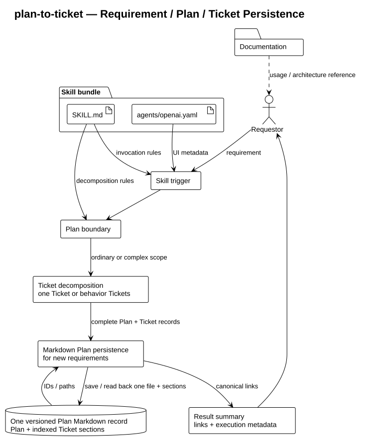

# Plan to Ticket

`plan-to-ticket` is the planning specialist for the main-agent workflow. It
turns one independent requirement, including a feature, bug fix, refactor,
documentation, configuration, dependency, test, or CI/CD change,
into one Plan and behavior Tickets, then persists the Plan and its Tickets to
GitHub Issues before branch work for every requirement. Ordinary requirements
use one Ticket; complex requirements may use multiple Tickets only for distinct
behavioral, dependency, or acceptance boundaries.

The executable skill source is maintained at
[`skills/plan-to-ticket/`](../../../skills/plan-to-ticket/). This document and
its diagrams are the migrated documentation for that local bundle; they do not
describe an application runtime or a custom API/database service. GitHub Issues
are the external durable store used by the planning workflow.

## Architecture


Overview source: [`plan-ticket.puml`](../../diagrams/plan-ticket.puml)

Detailed Plan-to-Ticket logical architecture:



The diagrams-as-code source is available at
[diagrams/plan-to-ticket-architecture.puml](diagrams/plan-to-ticket-architecture.puml).
The full explanation is in [architecture.md](architecture.md).

## What it does

When the skill is selected for a planning request, it:

1. Identifies the desired outcome and the minimum implementation foundations.
2. Gives an ordinary requirement one Ticket and separates complex work only at
   distinct behavioral, dependency, or acceptance boundaries.
3. Defines each Ticket's complete scope, acceptance criteria, Function
   Checklist, relevant context, test strategy, bounded level, cases, and
   validation.
4. Persists one Plan Issue containing its complete Ticket sections before branch
   work for every requirement, reusing stable markers to avoid duplicates.
5. Assigns or resumes one implementation branch and base branch for the Plan;
   every Ticket on that Plan shares the branch.
6. Returns the `Plan` and `Tickets` sections defined by the skill contract,
   including canonical Issue links and current execution metadata.

The skill is intentionally implementation-neutral. It uses repository context
and requires the available GitHub Issues connector for persisted planning, but it
does not implement code, add dependencies, force parallel implementation, or
invent commands for unknown tooling. The main agent dispatches fresh Ticket
owners under the
[scheduling policy](../../../AGENTS.md#multi-agent-delegation). A required GitHub read/write failure
blocks completion; the skill does not fall back to local Markdown or chat-only
storage.

## Naming contract

The skill uses stable, distinct names for every planning record:

| Record | Identifier | GitHub Issue or output title |
| --- | --- | --- |
| Plan | lowercase kebab-case `codex-plan-id` slug | `[PLAN] <short plan title>` |
| Ticket | repository-scoped `T` plus four digits, such as `T0016` | `### T0016` heading in the Plan Issue; behavior title in its body |
| Branch | lowercase Plan ID plus a short description | `<type>/<plan-id>-<short-description>` |

New Ticket IDs are selected by scanning both open and closed Issue bodies and
must be greater than every existing valid ID; IDs are never reused. Duplicate
IDs in closed historical Issues are legacy records and are not renumbered.
Extract all exact Ticket markers from every body, including multiple markers
in the same Issue and historical child records. Reuse unique matching sections
on retries; resolve ambiguity instead of creating duplicates. A one-Ticket
requirement has one `[PLAN]` Issue with one complete Ticket section. Stable
`### Tdddd` headings provide same-Issue index links regardless of behavior-title
changes. The canonical [persistence contract](../../../skills/plan-to-ticket/SKILL.md#persistence-and-delivery-contract)
defines complete metadata, read-back verification and failure behavior.

## Requirement-to-Ticket hierarchy

Every independent requirement has its own Plan Issue before branch work. An
ordinary requirement uses one Ticket section in that Issue. A complex requirement may use
multiple Tickets only for distinct behavioral, dependency, or acceptance
boundaries. A Ticket is the complete execution and acceptance unit represented
by one section in the Plan Issue; it has no independent delivery branch. Keep only real
dependencies between Tickets within the Plan.

The Plan's Tickets may share its commit and PR while retaining their behavior
boundaries. The runtime [scope contract](../../../skills/plan-to-ticket/SKILL.md#scope-and-sizing) and
[publication rules](../../../skills/github-push-when-ready/SKILL.md#readiness-and-boundaries)
own requirement scope, staging, commit descriptions and verification gates.

## Usage

Make the skill available in a Codex skills environment, then provide a change
request or implementation idea in a repository with a resolvable GitHub
remote. The frontmatter description in `SKILL.md` is used for skill selection.
The skill creates or updates one Plan Issue and its Ticket sections before
returning a successful Plan with execution-ready Ticket contracts. If the connector or required
permission is unavailable, the persisted result is blocked rather than replaced
by an unpersisted plan.

For repository-aware planning, include the relevant repository in the working
context. The skill will reuse existing architecture and conventions where they
are documented and available.

Every Plan output includes the branch handoff:

**Branch**

- <type>/plan-slug-short-description

**Base branch**

- main

Plan/Ticket contracts are updated before implementation edits. Supplementary
work for the same unmerged requirement updates its Ticket, adding a Ticket only
for a distinct boundary. An independent requirement always uses a new Plan,
even before another Plan merges. Follow the runtime
[scope-update contract](../../../skills/plan-to-ticket/SKILL.md#updating-scope).
The parent workflow may stop at local verification; the user chooses commit,
push, PR creation/update and merge. If delivered, all Tickets share the same
one-Plan branch/PR/merge boundary.

## Repository layout

```text
.
├── skills/plan-to-ticket/
│   ├── SKILL.md                          # Managed skill behavior and contract
│   └── agents/openai.yaml                 # Skill interface metadata
└── docs/skills/plan-to-ticket/
    ├── README.md                         # This documentation index
    ├── architecture.md                   # Logical architecture and boundaries
    └── diagrams/
        ├── plan-to-ticket-architecture.puml
        └── plan-to-ticket-architecture.svg
```

## Documentation

- [Architecture overview](architecture.md)
- [Architecture diagram source](diagrams/plan-to-ticket-architecture.puml)
- [Rendered architecture diagram](diagrams/plan-to-ticket-architecture.svg)

## Maintenance

Keep changes scoped to the skill's planning behavior or its supporting
documentation. When the persistence or output contract changes, update
`skills/plan-to-ticket/SKILL.md` and this documentation together. Keep
`agents/openai.yaml` limited to interface metadata rather than behavior.

## Historical format compatibility

New Plans persist all Ticket sections in one Issue. Historical Plan/child
records stay intact until extension; the original Plan then receives complete
contracts and evidence summaries, with source links retained and read-back
verified before child supersession or closure. Completed merged Plans are never
reopened. Follow the canonical
[migration and retry procedure](../../../skills/plan-to-ticket/SKILL.md#historical-child-issue-migration-on-extension).
