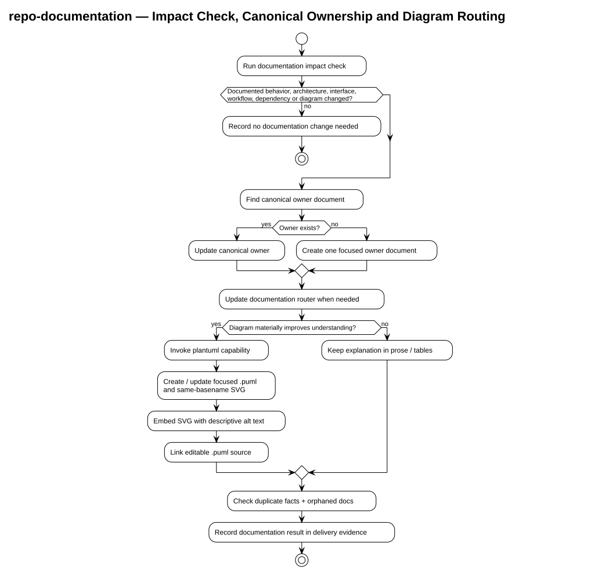

# Repo Documentation

`repo-documentation` governs canonical ownership and reachability for repository documentation. The installable skill and focused references live in [`skills/repo-documentation/`](../../../skills/repo-documentation/).

## What it provides

- A documentation impact check and canonical owner rules.
- A file standard, document type guide, lifecycle rules, and templates.
- A diagram placement and synchronization policy, with diagram types and rendering details owned by the companion `plantuml` skill.

## Usage

1. Check whether a change affects documented behavior, architecture, interfaces, dependencies, setup, operations, decisions, or diagram meaning.
2. Search for an existing owner before creating documentation; update it and link related pages.
3. Keep every maintained document reachable from the root README or a linked index.
4. For audits, check stale claims, duplicate facts, orphans, placement, naming, and broken router links.

## Diagram

Source: [`repo-documentation-flow.puml`](diagrams/repo-documentation-flow.puml).

This repository routes documentation from the root [`README.md`](../../../README.md). The current-state snapshot remains in [`docs/Repo_Current_State.md`](../../Repo_Current_State.md); this skill governs its documentation placement, while `repo-current-state` governs its content.
